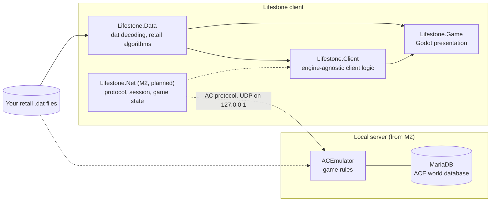

# Lifestone

**A faithful, single-player rebuild of Asheron's Call: a new Godot client for your own game files and a local
ACEmulator server.**

> **Early development: there is no gameplay yet.** Milestone 1 is done: you can fly and walk through all of Dereth,
> rendered from your own game files. Logging in and playing against the local server (M2) comes next. See
> [Status and roadmap](#status-and-roadmap).

<!--
  Hero image: add a hosted screenshot here. None are stored in the repository, because every render shows retail
  game data. For example:
  
-->

Lifestone is a new client for Asheron's Call (AC1) as it stood at the end of retail, when the official servers closed
in January 2017 (client 11.6096). It is written in C# on Godot 4.7.2 .NET and draws Dereth from the game's data files
that you already own (the `.dat` files, or "dats"). It will play the game against
[ACEmulator](https://github.com/ACEmulator/ACE) (ACE), the community's open-source AC server, running on your own
machine, so monsters, loot, spells and quests follow the rules the community rebuilt in ACE. The conveniences that
Decal-era plugins used to add, such as auto-buffing and AFK hunting and looting, are planned as features of the client
itself.

What Lifestone is not:

- **Not an official product.** It is an independent project, not affiliated with or endorsed by the rights holders
  of Asheron's Call.
- **Not a copy of the game.** It contains none of the game's data files or code; you supply your own dats.
- **Not an online client.** Everything runs on your computer and the server listens on 127.0.0.1 only. There is no
  multiplayer and no connecting to public servers.

## Status and roadmap

| Milestone | State | What it brings |
|---|---|---|
| **M1: Explore Dereth** | **Done** | The whole world, rendered from your dats, to fly and walk through |
| **M2: Log in** | Next | Log in to the local ACE server: your character, movement, server-spawned objects |
| Core gameplay | Planned | Combat, magic, inventory, NPCs, vendors and quests, with ACE as the authority |
| Built-in automation | Planned | Auto-buffing, then AFK dungeon hunting and looting ([automation vision](docs/automation-vision.md)) |
| Polish | Planned | Game UI, audio, packaging |

**Today** you can fly or walk anywhere in Dereth, at any time of day, into building interiors and down into
dungeons, and watch any spell in the game cast in the spell viewer.

**Not there yet:** everything the server creates (NPCs, monsters, lifestones, portals, doors, signs, chests) arrives
with M2, so towns look emptier than in retail. There is no player character in the world and no clothing, no
collision (walk mode follows the ground), no chat or game UI and no audio. Details: the
[M1 status and evidence](docs/milestones/m1-explore-dereth.md#status) and the [project goals](docs/goals.md).

## Highlights

- **Retail terrain:** the TexMerge blend (terrain types, alpha-mapped overlays, roads) with retail vertex lighting,
  checked against a CPU reference compositor.
- **Scenery** placed by the retail algorithm, so every tree and rock stands where retail put it.
- **Statics and buildings** with retail LOD, translucency and cut-outs, running their default animations and
  effects: torch flames, chimney smoke, windmills, fountains.
- **Interiors and dungeons** drawn through retail's portal visibility: only the cells you can see are rendered.
- **Sky and time of day:** sun, light, fog and sky objects from the game's own region data, driven by the Dereth
  calendar, with a time slider.
- **Streaming with a floating origin:** landblocks load around you on worker threads within a 4 ms per-frame budget,
  and the scene recentres as you travel. A 200 m/s flight from Holtburg to Arwic holds vsync, with its slowest frame
  at about 16 ms on the development machine.
- **Spell viewer:** cast any of the 6,266 spells, with the caster's gestures, glows, projectiles and impacts.
- **Teleport panel** with ACE's towns and places plus curated dungeons and building interiors.
- **Golden viewpoints and a smoke suite:** 18 fixed views for side-by-side comparison with retail, and one command
  that builds, tests and runs every engine check off-screen.

_No screenshots are stored here, because every image of Lifestone shows retail game data. Run it with your own dats,
or render the [golden viewpoints](#smoke-suite-and-golden-viewpoints)._

## Quick start

Clone the repository with Git. Every command below runs from its root, written `<repo>` in paths. (A downloaded ZIP
marks every file as coming from the internet, and PowerShell then refuses the unsigned scripts in `tools\`; run
`Unblock-File` on the ZIP before extracting it.)

### 1. Prerequisites

- **Windows 10 or 11, x64**, with a GPU that runs Direct3D 12 or Vulkan.
- **[PowerShell 7](https://learn.microsoft.com/powershell/scripting/install/installing-powershell-on-windows)**
  (`pwsh`) for the scripts in `tools\`.
- **[.NET 10 SDK](https://dotnet.microsoft.com/download/dotnet/10.0)**, 10.0.401 or a later 10.0 SDK (see
  [`global.json`](global.json)). No administrator rights are needed: a per-user install in
  `%LOCALAPPDATA%\Microsoft\dotnet` is found by itself and does not need to be on `PATH`. Microsoft's
  [dotnet-install script](https://learn.microsoft.com/dotnet/core/tools/dotnet-install-script) makes one with
  `-Channel 10.0 -InstallDir "$env:LOCALAPPDATA\Microsoft\dotnet"`.
- **Godot 4.7.2, .NET edition**, for Windows: `Godot_v4.7.2-stable_mono_win64.zip` from the official
  [godotengine/godot](https://github.com/godotengine/godot/releases) release. The launcher finds it by itself in a
  `Tools` folder beside your clone, so the simplest setup is to unzip it there:

  ```text
  <repo>\..\Tools\Godot_v4.7.2-stable_mono_win64\Godot_v4.7.2-stable_mono_win64.exe
  ```

  Anywhere else, tell the launcher where it is, either with `-GodotExe <path>` on each run or for the current terminal:

  ```powershell
  $env:LIFESTONE_GODOT = 'C:\Games\Godot\Godot_v4.7.2-stable_mono_win64\Godot_v4.7.2-stable_mono_win64.exe'
  ```

  A Godot on `PATH` is used only if it is the 4.7.2 .NET build. Tip: an empty file named `._sc_` next to the Godot
  executable keeps Godot's editor settings and caches beside it instead of in `%APPDATA%`.
- **Your own Asheron's Call data files** (next step).

### 2. Add your data files

Copy the end-of-retail dats from your Asheron's Call installation folder (the one holding `acclient.exe`) into a
`client` folder at the root of the repository (`<repo>\client`, which git ignores). Copying all four now saves a trip
at M2:

| File | Needed | Contents |
|---|---|---|
| `client_portal.dat` | Required | Models, textures, the region, spell and animation tables (iteration 2072) |
| `client_cell_1.dat` | Required | Landblocks, buildings and dungeons (iteration 982) |
| `client_highres.dat` | Recommended | High-resolution textures (iteration 497); without it textures use their standard versions |
| `client_local_English.dat` | From M2 | Strings and UI layouts (iteration 994); the local server requires it |

The game opens them read-only and never modifies them. To check you have the end-of-retail set, look for the
`dats open` line the game prints at start-up: it should read `iterations=p2072-c982-l994-h497` (portal, cell, local,
highres; `x` marks a missing file). Other iterations are untested. For a deeper check (Python 3, optional), this
walks one file read-only and reports its iteration and a PASS or FAIL verdict:

```powershell
python -I tools\installer\datcheck.py client\client_portal.dat
```

To keep the dats elsewhere, pass `--dat-dir=<folder>` or set `LIFESTONE_DAT_DIR`. This applies to the game only: the
local server always reads `<repo>\client`.

### 3. Run

```powershell
pwsh -File tools\godot.ps1 -Run                                    # build, then explore from Holtburg
pwsh -File tools\godot.ps1 -Run -GameArgs:'--start=arwic --walk'   # start on foot in Arwic
pwsh -File tools\godot.ps1 -Run -GameArgs:'--scene=spellviewer'    # the spell viewer
pwsh -File tools\godot.ps1 -Run -GameArgs:'--help'                 # print every command-line option
pwsh -File tools\godot.ps1                                         # open the project in the Godot editor
```

`tools\godot.ps1` builds the game first and finds a per-user .NET install by itself. The settings it needs apply only
to the processes it starts, so there is nothing to set up in your shell. Game options go inside `-GameArgs:'...'`;
`Get-Help tools\godot.ps1 -Full` lists the launcher's own options (rendering driver, resolution, dat folder,
off-screen runs, timeouts).

### Controls

**In the world**

| Input | Action |
|---|---|
| `W` `A` `S` `D` | Move |
| `E` / `Q` | Up / down (fly mode) |
| Hold `Shift` / `Ctrl` | 5x faster / 5x slower |
| Mouse wheel | Change flying speed |
| Hold right mouse button | Look around |
| `Tab` | Keep mouse look on without holding the button (`Esc` releases the mouse) |
| `F` | Switch between flying and walking on the ground |
| `T` | Teleport panel: towns, dungeons and building interiors |
| `F7` / `Shift`+`F7` | Next / previous curated interior |
| `F3` | Performance overlay |
| `F1` | About: license, credits and legal notices |
| `F9` | Debug: draw every loaded cell (portal visibility off) |

The time panel (bottom right) sets the time of day and its speed.

**In the spell viewer**

| Input | Action |
|---|---|
| Double-click a spell in the list | Cast it (type in the search box to filter by name, id or school) |
| Drag with the right mouse button, or the arrow keys | Orbit the camera |
| Mouse wheel | Zoom |
| Drag with the middle mouse button | Raise or lower the view |
| `Home` | Reset the camera |
| `Space` | Pause or resume |
| `R` | Cast the last spell again |

### Useful options

| Option | Effect |
|---|---|
| `--start=LOC` | Where to start: `holtburg` (default), `arwic`, a curated interior such as `mines-of-despair`, a landblock (`A9B4`) or a cell (`A9B40019`) |
| `--walk` | Start on foot |
| `--time-of-day=F` | Time of day as a fraction of the day, 0 to 1 (default 0.5) |
| `--time-speed=X` | Game seconds per real second (0 pauses; 1 is retail) |
| `--vsync=off --max-fps=0` | Uncapped frame rate, for benchmarking (with `--vsync=off` alone the cap is the display's refresh rate) |
| `--load-radius=N` | Landblock rings to stream around you (default 8, as retail) |
| `--retail-normals`, `--retail-sky-anchor` | Restore retail's rendering quirks (see [Principles](#principles)) |
| `--dat-dir=DIR` | Read the dats from another folder |

## How it works



- **Lifestone.Data** (`src/Lifestone.Data`, no engine) reads the dats read-only through Chorizite DatReaderWriter and
  holds every decoder and retail algorithm: textures, models, terrain blending, scenery placement, cells and portals,
  animation, particle effects and spells. It produces plain data in AC's own coordinates.
- **Lifestone.Client** (`src/Lifestone.Client`, no engine, no I/O) decides what to load, where things are and which
  retail render state applies: streaming and the floating origin, the worker pool and frame budget, caches, object
  LOD, living statics, interior visibility, the sky, navigation and the option registry. Because none of it depends on
  Godot, it is unit-tested directly and the engine stays replaceable.
- **Lifestone.Game** (`src/Lifestone.Game`, Godot 4.7.2 .NET) is presentation only: nodes, meshes, materials, shaders
  and panels. AC's Z-up world becomes Godot's Y-up world in exactly one place, `scripts/Core/AcToGodot.cs`, which also
  reverses the triangle winding.
- **Lifestone.Net** (M2, planned) will hold the AC network protocol, login and the game-state model, again with no
  engine dependency ([protocol](docs/protocol.md)).
- **The server** (`server/`, from M2) builds ACEmulator from source at a pinned release, unpacks a portable MariaDB,
  loads the pinned ACE world database and runs both as the current user on 127.0.0.1. AC was server-authoritative, so
  this is where the game rules live. See [server/README.md](server/README.md).

## Principles

- **Retail fidelity, with sources.** Every algorithm and constant cites where it comes from in a code comment: ACE,
  the retail client by function name (no retail code is copied), OpenAC, ACViewer or WorldBuilder. Unknown behaviour
  becomes a named, logged TODO rather than a guess, and conformance tests run over the real dats.
- **Without retail's glitches.** Where retail had a visible rendering artifact, Lifestone fixes it by default and a
  flag restores retail exactly: `--retail-normals` brings back the lighting seams at landblock edges and
  `--retail-sky-anchor` the sky's jump at every landblock crossing.
- **Your machine stays yours.** No administrator rights, installers, services or system settings. Servers listen on
  127.0.0.1 only, and the game downloads nothing at runtime. Server setup is the only step that goes online: it clones
  ACE at a pinned commit and restores its NuGet packages from nuget.org, and downloads MariaDB and the world database,
  both checked by SHA-256. There is no plugin loading: the client loads no DLLs or other code from outside its own
  build, and ACE's mod folder (`server/runtime/ace-mods`) is created empty. Customisation will come from data
  profiles and, later, an optional sandboxed script tier with no file or network access.
- **Automation built in.** The client core is being built as a game-state model plus an action API that the UI, the
  automation and the tests all drive. Automation will send only the actions a player could, and only to a local
  server.

## Repository layout

```text
Lifestone.slnx          the solution: three projects and their tests
Directory.Build.props   shared build settings (net10.0, nullable, warnings as errors)
global.json             .NET SDK pin
NuGet.config            packages from nuget.org only
src/Lifestone.Data/     dat decoding and retail algorithms (no engine)
src/Lifestone.Client/   engine-agnostic client logic (no engine, no I/O)
src/Lifestone.Game/     the Godot project: scenes, scripts, shaders
tests/                  xUnit tests for Lifestone.Data and Lifestone.Client
server/                 the localhost ACE and MariaDB backend (setup, start, stop)
tools/                  godot.ps1 launcher, smoke.ps1 suite, terrain-golden.ps1, hero-video.ps1, Python helpers
docs/                   design docs, milestones, research notes and third-party sources
client/                 your retail dats (you create it; ignored by git)
```

## Development

### Build and test

To build and run the unit tests without Godot, in PowerShell 7 from the repository root:

```powershell
# Only for a per-user .NET install that is not on PATH; this applies to the current terminal only.
$env:DOTNET_ROOT = "$env:LOCALAPPDATA\Microsoft\dotnet"; $env:PATH = "$env:DOTNET_ROOT;$env:PATH"
# Keep the SDK's first run from adding to your user PATH or creating an HTTPS development certificate.
$env:DOTNET_ADD_GLOBAL_TOOLS_TO_PATH = 'false'; $env:DOTNET_GENERATE_ASPNET_CERTIFICATE = 'false'
$env:DOTNET_CLI_TELEMETRY_OPTOUT = '1'; $env:DOTNET_NOLOGO = '1'

dotnet build Lifestone.slnx --disable-build-servers
dotnet test Lifestone.slnx --disable-build-servers
```

Or in Git Bash:

```bash
export DOTNET_ROOT="$(cygpath -u "$LOCALAPPDATA")/Microsoft/dotnet"; export PATH="$DOTNET_ROOT:$PATH"
export DOTNET_CLI_TELEMETRY_OPTOUT=1 DOTNET_NOLOGO=1 DOTNET_ADD_GLOBAL_TOOLS_TO_PATH=false DOTNET_GENERATE_ASPNET_CERTIFICATE=false
dotnet build Lifestone.slnx --disable-build-servers
dotnet test Lifestone.slnx --disable-build-servers
```

- The build treats every warning as an error, with the analysers pinned to the .NET 10 defaults. Packages come from
  nuget.org only (`NuGet.config`), and new ones are added deliberately.
- Tests that need the retail dats are reported as skipped, not failed, when the files are missing.
- `--disable-build-servers` keeps MSBuild and compiler servers from lingering after a build.

### Smoke suite and golden viewpoints

- `pwsh -File tools\smoke.ps1` is the integration suite: the build, the tests, `--help`, the terrain golden test,
  the four engine check suites, a spell-viewer showcase, the golden viewpoints and the Holtburg-to-Arwic flight, all
  off-screen, with a summary table and logs in `cache\smoke\`. It needs the dats and Godot.
- The golden viewpoints render to `docs/screenshots/m1/golden/` (ignored by git) with the positions and times needed
  to take the same views in the retail client:

  ```powershell
  pwsh -File tools\godot.ps1 -Run -Offscreen -IsolateUserData -TimeoutSeconds 300 -GameArgs:'--golden-viewpoints'
  ```
- Every command-line option is registered once, with its help, in `src/Lifestone.Client/Options/OptionCatalog.cs`;
  a test fails when a parsed option is missing there.

### Documentation

- **Project**
  - [Goals](docs/goals.md): single-player fidelity, built-in automation, machine safety, data
  - [Automation vision](docs/automation-vision.md): built-in automation, from auto-buffing to AFK hunting
  - [M1: Explore Dereth](docs/milestones/m1-explore-dereth.md): the first milestone, with its status and evidence
  - [Protocol](docs/protocol.md): the AC network protocol as ACE implements it, for M2
  - [Local server](server/README.md): setting up and running ACE and MariaDB on 127.0.0.1
- **Data layer**
  - [Textures](docs/textures.md): decoding and the exact retail render state
  - [Terrain shader](docs/terrain-shader.md): the TexMerge specification
  - [Cells](src/Lifestone.Data/World/Cells/README.md): statics, buildings, interiors and dungeons
  - [Spell visuals](docs/spell-visuals.md): from a spell id to particles
- **Godot client**
  - [Game core](docs/game-core.md): services, streaming, floating origin, options, smoke suite
  - [Render contract](docs/render-contract.md): shaders, blending, materials, caches
  - [Terrain renderer](docs/terrain-renderer.md), [objects](docs/objects.md) (scenery, statics, buildings, living
    statics), [interiors and dungeons](docs/interiors.md), [sky and time of day](docs/sky.md)
  - [Navigation and golden viewpoints](docs/navigation.md), [spell viewer](docs/spell-viewer.md)
  - [Hero video](docs/hero-video.md): a trailer rendered from your dats
- **Sources:** [docs/third-party](docs/third-party/) lists the sources behind each area.

### Contributing

Issues and pull requests are welcome. Contributions are made under the repository's license (see
[License](#license)).

- **Cite retail behaviour.** Name the source of every algorithm and constant (ACE file, retail function name, or
  another project at a pinned commit) in a comment. Ported files carry a header with the source repository, commit,
  path and license, and each area lists its sources in `docs/third-party/`.
- **Never commit retail data.** No dats, nothing decoded from them, and no screenshots or videos rendered from them.
  `.gitignore` keeps common image and video formats out anywhere in the tree as a safety net.
- **Compare against retail.** Rendering changes are checked against the golden viewpoints and the retail client;
  behaviour that differs from retail on purpose is documented and has a flag that restores retail.
- **Keep it green:** zero warnings, `dotnet test` passing, and `tools\smoke.ps1` for anything that touches rendering
  or streaming.

## FAQ

**Do I need the original game? Does Lifestone include any of it?** You need the data files from your own copy of
Asheron's Call. Lifestone contains none of the game's data files or code: it is original open-source software that
reads the files you provide, without modifying them, and its server is ACEmulator, an open-source reimplementation.

**Can I play online, or with friends?** No. Lifestone is single-player: its server runs on your computer and listens
on 127.0.0.1 only, and the automation is designed to refuse to run against any other server.

**Why not just run the retail client against a local ACE server?** You can, and many players do. Lifestone aims at
what that cannot offer: a modern, maintainable engine, retail visuals without retail's glitches, a client whose
source you can read and change, and automation built in rather than injected through Decal plugins.

**Why Godot? Could the engine be swapped?** Godot is open source (MIT), runs C# well and is small to ship. All
decoding and client logic live in plain .NET libraries with no engine references, so another engine would replace
only `Lifestone.Game`.

**Linux or macOS?** Not yet. Lifestone is developed and tested on Windows only, and the launcher scripts look for the
Windows builds of .NET and Godot. The code itself is plain .NET and Godot, so other platforms are possible later.

**Where are the game rules?** On the server. Asheron's Call was server-authoritative: combat, loot, spells, AI and
quests were decided by the servers, never by the client. Lifestone takes them from ACEmulator and its world database;
the client sends your actions and shows the results.

## License

Lifestone is free software, licensed under the **GNU Affero General Public License v3.0** (see [LICENSE](LICENSE)),
and comes with **no warranty**. Whether the grant is "AGPL-3.0-only" or "AGPL-3.0-or-later" has not been decided yet;
the two data files extracted from ACE's world database are marked AGPL-3.0-only. The game shows these notices in its
About panel (`F1`); their text lives in `src/Lifestone.Client/LegalNotices.cs`, and a test keeps the list of works
below in step with it.

Lifestone builds on these works, which keep their own licenses:

| Work | License | Used for |
|---|---|---|
| ACEmulator (ACE) | AGPL-3.0 | the bundled server; game rules and algorithms ported from its source |
| ACE-World-16PY-Patches | AGPL-3.0 | the world database: places, portals and spell visuals |
| OpenAC | MIT | terrain blending code (TexMerge) |
| Chorizite DatReaderWriter | MIT | reading the dat files |
| WorldBuilder | MIT | landscape and terrain blending reference |
| ACViewer | GPL-3.0 | terrain blending, named locations and test oracles |
| Godot Engine | MIT | the game engine |

From M2, server setup also builds ACE and downloads MariaDB Server 11.4 (GPL-2.0) on your machine. Neither is stored
in this repository or redistributed by it, and both run as separate programs; see
[server/README.md](server/README.md#licensing).

Direct NuGet dependencies, restored from nuget.org only:

| Package | Version | License | Use |
|---|---|---|---|
| Chorizite.DatReaderWriter | 2.1.9 | MIT | reading the dat files |
| Godot.NET.Sdk, GodotSharp, GodotSharpEditor, Godot.SourceGenerators | 4.7.2 | MIT | the Godot C# SDK |
| xunit, xunit.runner.visualstudio, Microsoft.NET.Test.Sdk | 2.9.3, 3.1.4, 17.14.1 | Apache-2.0 / MIT | tests only |

DatReaderWriter also declares DotNet.Standard.Common 2.0.1 and ZLibDotNet 0.1.1, which its .NET 8 build does not use;
they are restored but kept out of every build output (`Directory.Build.props`).

Asheron's Call and its data files are the property of their respective owners. Lifestone is not affiliated with or
endorsed by them, and this repository contains no retail game data: you must supply your own client files.

## Acknowledgements

Lifestone stands on the work of the Asheron's Call community:

- the [ACEmulator](https://github.com/ACEmulator/ACE) team and contributors, for the server, the
  [world database](https://github.com/ACEmulator/ACE-World-16PY-Patches) and years of work recovering how AC behaves;
- [Chorizite](https://github.com/Chorizite), for [DatReaderWriter](https://github.com/Chorizite/DatReaderWriter) and
  [WorldBuilder](https://github.com/Chorizite/WorldBuilder);
- [OpenAC](https://github.com/eriknihlen/OpenAC), for its terrain blending;
- [ACViewer](https://github.com/ACEmulator/ACViewer), for terrain blending, named locations and test oracles;
- [Mag-nus/acclient-AI-RE](https://github.com/Mag-nus/acclient-AI-RE), for documenting the retail client;
- the [Godot Engine](https://godotengine.org) contributors;
- and Turbine's original Asheron's Call team, for Dereth.
