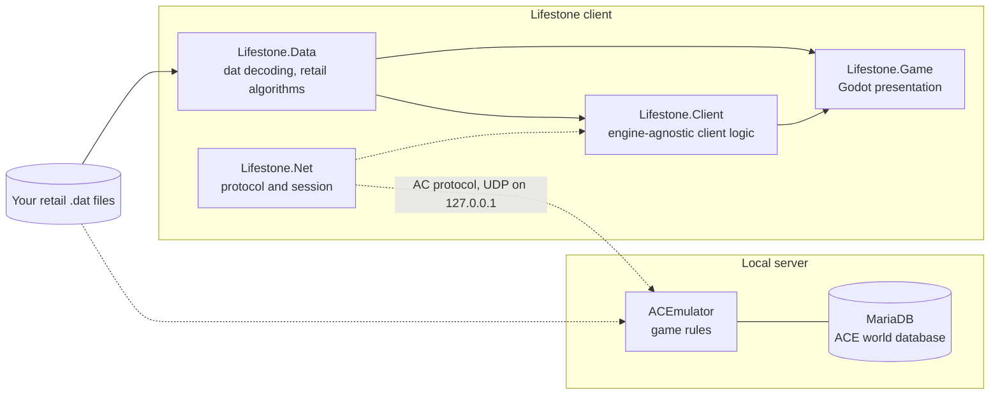

# Lifestone

**A faithful, single-player rebuild of Asheron's Call: a new Godot client for your own game files and a local
ACEmulator server.**

> **Early development.** Milestones 1 to 4 are done: you can fly and walk through all of Dereth, rendered from your
> own game files; log in to the bundled local server in the retail interface; watch a mage buff, fight and die in
> the Black Spawn Den, with lights and sound; and play a fighter who hunts near Holtburg with melee or missile, loots,
> heals and trades with vendors, with an auto-buff switch. Three characters play whole journeys on their own for the
> tests. See [Status and roadmap](#status-and-roadmap).

<!--
  Hero image: add a hosted screenshot here. None are stored in the repository, because every render shows retail
  game data. For example:
  
-->

Lifestone is a new client for Asheron's Call (AC1) as it stood at the end of retail, when the official servers closed
in January 2017 (client 11.6096). It is written in C# on Godot 4.7.2 .NET and draws Dereth from the game's data files
that you already own (the `.dat` files, or "dats"). It will play the game against
[ACEmulator](https://github.com/ACEmulator/ACE) (ACE), the community's open-source AC server, running on your own
machine, so monsters, loot, spells and quests follow the rules the community rebuilt in ACE. The conveniences that
Decal-era plugins used to add are becoming features of the client itself: auto-buff is built (a re-buff driver and a
key that turns it on and off), and AFK hunting and looting run as the test loops, not yet as a player feature.

What Lifestone is not:

- **Not an official product.** It is an independent project, not affiliated with or endorsed by the rights holders
  of Asheron's Call.
- **Not a copy of the game.** It contains none of the game's data files or code; you supply your own dats.
- **Not an online client.** Everything runs on your computer and the server listens on 127.0.0.1 only. There is no
  multiplayer and no connecting to public servers.

## Status and roadmap

| Milestone | State | What it brings |
|---|---|---|
| **M1: Explore Dereth** | **Done** | The whole world, rendered from your dats, to fly and walk through |
| **[M2: Log in](docs/milestones/m2-log-in.md)** | **Done** | Log in to the local ACE server, in the retail interface and through retail portal space: your character, movement, server-spawned objects |
| **[M3: Fights and sound](docs/milestones/m3-lights-and-sound.md)** | **Done** | A level-126 mage buffs in all three schools, fights and dies in the Black Spawn Den: casts, projectiles and impacts on screen, dynamic lights, the game's sound, the retail panels with live content |
| **[M4: Fights and loot](docs/milestones/m4-fights-and-loot.md)** | **Done** | A fighter on the Low B belt and in the forest near Holtburg: melee and missile with the power bar, corpses looted, kits and potions, vendors and appraisal, the shortcut bar; the retail panels with live content; auto-buff; a wayfinder that walks planned routes; three self-driving characters that play whole journeys for the tests; a 30-second hero video cut from their live takes |
| **[M5: The first dungeon](docs/milestones/m5-first-dungeon.md)** | In progress (item 0 of 9 done) | The game starts to play itself: a mage hunts the Black Spawn Den on its own for a day, buffing, looting, selling, buying, dying and recovering without the server mod's help, with a key that hands the controls to you and back; dungeons as data; a day-long run on screen; the first batch of what a player at the keys needs (the Yes/No dialog, saved settings, editable spell bars, slash commands); doors and lifestones made solid |
| M6: Dungeons and regions | Next | More hunting grounds written as data and proved live, the other classes in the autopilot, the second batch of the retail interface |
| More gameplay | Planned | NPCs and quests, the remaining panels, more of Dereth's rules through ACE; later, the player-run service bots of retail (buff, tinker, dye and craft bots) run by the client, and quests the game does for you |
| Built-in automation | Started | The loops that test the game today drive the same action API the automation will use; auto-buff is done, AFK hunting and looting is next ([automation vision](docs/automation-vision.md)) |
| Polish | Planned | The remaining UI, larger window sizes, packaging |

**Today** you can fly or walk anywhere in Dereth, at any time of day, into building interiors and down into
dungeons, and watch any spell cast in the spell viewer. With the bundled server you log in through the retail
character screens and portal space, walk among ACE's NPCs and monsters, and play in the retail interface: the chat,
the vitals, the inventory and paperdoll, the spellbook and spell bars, the combat window and power bar, a corpse's or
chest's contents, a vendor's window, the examine panel and the shortcut bar. The `Pause` key turns auto-buff on and
off. Test loops play three characters for the checks, each on its own route, planned by Lifestone's own wayfinder: the
BSD Mage buffs, fights and dies in the Black Spawn Den and recovers; the Holtburg Brawler (melee) and the Holtburg
Archer (missile) buff, hunt, heal, loot, sell and recall home.

**Not there yet:** quests, fellowships, crafting, housing and most NPC conversations; the panels retail had beyond
those above answer "Not in Lifestone" for now; only the 800x600 window is tested. Objects the server owns (doors,
lifestones, other creatures) are not yet solid on the client, so you can walk through a closed door, and creatures that
crowd you can overlap and snap back to where the server has them (`TODO(d25-server-object-host)`, [physics](docs/physics.md)). Details: each milestone's status
section, and the [project goals](docs/goals.md).

## Highlights

- **Retail terrain:** the TexMerge blend (terrain types, alpha-mapped overlays, roads) with retail vertex lighting,
  checked against a CPU reference compositor.
- **Scenery** placed by the retail algorithm, so every tree and rock stands where retail put it.
- **Statics and buildings** with retail LOD, translucency and cut-outs, running their default animations and
  effects: torch flames, chimney smoke, windmills, fountains.
- **Interiors and dungeons** drawn through retail's portal visibility: only the cells you can see are rendered.
- **Sky and time of day:** sun, light, fog and sky objects from the game's own region data, driven by the Dereth
  calendar, with a time slider.
- **Streaming with a floating origin:** landblocks load around you on worker threads within a 4 ms per-frame budget,
  and the scene recentres as you travel. A 200 m/s flight from Holtburg to Arwic holds vsync, with its slowest frame
  at about 16 ms on the development machine.
- **Spell viewer:** cast any of the 6,266 spells, with the caster's gestures, glows, projectiles and impacts.
- **Teleport panel** with ACE's towns and places plus curated dungeons and building interiors.
- **The retail interface, rebuilt from the dats:** the windows, panels and fonts are drawn from the game's own UI
  layouts, with retail's key map; items show their own icons and models.
- **Characters in the world:** your character and everyone else's, dressed in their armour and clothing, animated
  from the retail motion tables, holding what they wield; spells, projectiles and their lights on screen; the game's
  own sound.
- **Combat, loot and trade on ACE's rules:** melee, missile and magic through the combat window and the power bar,
  health meters, deaths with vitae and corpses, looting, healing kits and potions, buying and selling at vendors,
  appraisal.
- **A client built around an action API:** the UI, the test loops and (later) the automation all act through the same
  API, and every action is checked against what the server answers.
- **Auto-buff:** a re-buff driver recasts any buff that is about to run out, on the session clock and never in a
  fight, and the `Pause` key switches it on and off (`--buff-auto`).
- **Self-driving journeys:** a mage and two fighters (melee and missile) play a whole day on their own, from a wayfinder
  that plans routes over the world's real collision and yields to your own movement keys, through buffing, hunting,
  looting, healing with kits and Harm Self, vendors and Lifestone Recall home, and are judged station by station.
  Every live gate starts them from freshly re-created characters.
- **Golden viewpoints and a smoke suite:** 18 fixed views for side-by-side comparison with retail, and one command
  that builds, tests and runs every engine check off-screen, plus loopback tests against the local server.

_No screenshots are stored here, because every image of Lifestone shows retail game data. Run it with your own dats,
or render the [golden viewpoints](#smoke-suite-and-golden-viewpoints)._

## Quick start

Clone the repository with Git. Every command below runs from its root, written `<repo>` in paths. (A downloaded ZIP
marks every file as coming from the internet, and PowerShell then refuses the unsigned scripts in `tools\`; run
`Unblock-File` on the ZIP before extracting it.)

### 1. Prerequisites

- **Windows 10 or 11, x64**, with a GPU that runs Direct3D 12 or Vulkan.
- **[PowerShell 7](https://learn.microsoft.com/powershell/scripting/install/installing-powershell-on-windows)**
  (`pwsh`) for the scripts in `tools\`.
- **[.NET 10 SDK](https://dotnet.microsoft.com/download/dotnet/10.0)**, 10.0.401 or a later 10.0 SDK (see
  [`global.json`](global.json)). No administrator rights are needed: a per-user install in
  `%LOCALAPPDATA%\Microsoft\dotnet` is found by itself and does not need to be on `PATH`. Microsoft's
  [dotnet-install script](https://learn.microsoft.com/dotnet/core/tools/dotnet-install-script) makes one with
  `-Channel 10.0 -InstallDir "$env:LOCALAPPDATA\Microsoft\dotnet"`.
- **Godot 4.7.2, .NET edition**, for Windows: `Godot_v4.7.2-stable_mono_win64.zip` from the official
  [godotengine/godot](https://github.com/godotengine/godot/releases) release. The launcher finds it by itself in a
  `Tools` folder beside your clone, so the simplest setup is to unzip it there:

  ```text
  <repo>\..\Tools\Godot_v4.7.2-stable_mono_win64\Godot_v4.7.2-stable_mono_win64.exe
  ```

  Anywhere else, tell the launcher where it is, either with `-GodotExe <path>` on each run or for the current terminal:

  ```powershell
  $env:LIFESTONE_GODOT = 'C:\Games\Godot\Godot_v4.7.2-stable_mono_win64\Godot_v4.7.2-stable_mono_win64.exe'
  ```

  A Godot on `PATH` is used only if it is the 4.7.2 .NET build. Tip: an empty file named `._sc_` next to the Godot
  executable keeps Godot's editor settings and caches beside it instead of in `%APPDATA%`.
- **Your own Asheron's Call data files** (next step).

### 2. Add your data files

Copy the end-of-retail dats from your Asheron's Call installation folder (the one holding `acclient.exe`) into a
`client` folder at the root of the repository (`<repo>\client`, which git ignores):

| File | Needed | Contents |
|---|---|---|
| `client_portal.dat` | Required | Models, textures, the region, spell and animation tables (iteration 2072) |
| `client_cell_1.dat` | Required | Landblocks, buildings and dungeons (iteration 982) |
| `client_highres.dat` | Recommended | High-resolution textures (iteration 497); without it textures use their standard versions |
| `client_local_English.dat` | Required to play | Strings and UI layouts (iteration 994); the retail interface and the local server need it |

The game opens them read-only and never modifies them. To check you have the end-of-retail set, look for the
`dats open` line the game prints at start-up: it should read `iterations=p2072-c982-l994-h497` (portal, cell, local,
highres; `x` marks a missing file). Other iterations are untested. For a deeper check (Python 3, optional), this
walks one file read-only and reports its iteration and a PASS or FAIL verdict:

```powershell
python -I tools\installer\datcheck.py client\client_portal.dat
```

To keep the dats elsewhere, pass `--dat-dir=<folder>` or set `LIFESTONE_DAT_DIR`. This applies to the game only: the
local server always reads `<repo>\client`.

### 3. Run

```powershell
pwsh -File tools\godot.ps1 -Run                                    # build, then explore from Holtburg
pwsh -File tools\godot.ps1 -Run -GameArgs:'--start=arwic --walk'   # start on foot in Arwic
pwsh -File tools\godot.ps1 -Run -GameArgs:'--scene=spellviewer'    # the spell viewer
pwsh -File tools\godot.ps1 -Run -GameArgs:'--help'                 # print every command-line option
pwsh -File tools\godot.ps1                                         # open the project in the Godot editor
```

`tools\godot.ps1` builds the game first and finds a per-user .NET install by itself. The settings it needs apply only
to the processes it starts, so there is nothing to set up in your shell. Game options go inside `-GameArgs:'...'`;
`Get-Help tools\godot.ps1 -Full` lists the launcher's own options (rendering driver, resolution, dat folder,
off-screen runs, timeouts).

### 4. Play on the local server

The game itself needs the bundled server: ACEmulator and a portable MariaDB, set up once and run as your user on
127.0.0.1 only ([server/README.md](server/README.md) has the details, the pins and the licences).

```powershell
pwsh -NoProfile -ExecutionPolicy Bypass -File server\setup-server.ps1   # once: builds ACE, unpacks MariaDB, loads the world
pwsh -File tools\play.ps1                                               # start the server if needed, log in, play
pwsh -File tools\play.ps1 -Character "Name"                             # straight into one character
```

`tools\play.ps1` starts the backend when it is not running, signs in with the account setup created (the game reads
the password itself; no password ever goes on a command line), shows retail's character screens and enters the world
through portal space. When the game exits it stops only what it started; `-KeepServer` keeps it running.

### Controls

**In the world**

| Input | Action |
|---|---|
| `W` `A` `S` `D` | Move |
| `E` / `Q` | Up / down (fly mode) |
| Hold `Shift` / `Ctrl` | 5x faster / 5x slower |
| Mouse wheel | Change flying speed |
| Hold right mouse button | Look around |
| `Tab` | Keep mouse look on without holding the button (`Esc` releases the mouse) |
| `F` | Switch between flying and walking on the ground |
| `T` | Teleport panel: towns, dungeons and building interiors |
| `F7` / `Shift`+`F7` | Next / previous curated interior |
| `F3` | Performance overlay |
| `F1` | About: license, credits and legal notices |
| `F9` | Debug: draw every loaded cell (portal visibility off) |

The time panel (bottom right) sets the time of day and its speed.

**In the game (`tools\play.ps1`, the retail interface)**

The game uses retail's default key map, read from your dats (movement, the panels, combat). Lifestone adds:

| Input | Action |
|---|---|
| `1`-`9`, `Alt`+`1`-`9` | Use the item on shortcut slot 1-9 or 10-18 (drag an item from a pack onto the bar to add it) |
| `F7` | Lifestone's tools panel: Places (search and teleport), Where am I, Add XP (needs the bundled server with the Lifestone mod) |
| `Scroll Lock` | Lifestone's automation inspector (read-only) |
| `Pause` | Auto-buff on or off; the chat says so in a `[Lifestone]` line. A character without a buff profile (only the BSD Mage and the two fighters have one) gets a notice and it stays off |
| `Shift`+`Esc` | Log off (retail's End Character Session) |
| `F3` / `F1` | Performance overlay / About |

`F7`, `Scroll Lock` and `Pause` are keys retail's default key map leaves unbound (`docs/retail-ui.md` section 22.1); the
number keys are retail's own shortcut-bar keys, and the accent-grave key (`` ` ``) is retail's own combat key: peace to
the weapon's combat mode and back, under the same rules as the combat window's button. Running is retail's own
run key; a wayfinder run stops as soon as you press a movement key.

**In the spell viewer**

| Input | Action |
|---|---|
| Double-click a spell in the list | Cast it (type in the search box to filter by name, id or school) |
| Drag with the right mouse button, or the arrow keys | Orbit the camera |
| Mouse wheel | Zoom |
| Drag with the middle mouse button | Raise or lower the view |
| `Home` | Reset the camera |
| `Space` | Pause or resume |
| `R` | Cast the last spell again |

### Useful options

| Option | Effect |
|---|---|
| `--start=LOC` | Where to start: `holtburg` (default), `arwic`, a curated interior such as `mines-of-despair`, a landblock (`A9B4`) or a cell (`A9B40019`) |
| `--walk` | Start on foot |
| `--time-of-day=F` | Time of day as a fraction of the day, 0 to 1 (default 0.5) |
| `--time-speed=X` | Game seconds per real second (0 pauses; 1 is retail) |
| `--vsync=off --max-fps=0` | Uncapped frame rate, for benchmarking (with `--vsync=off` alone the cap is the display's refresh rate) |
| `--soak-line-s=S` | Seconds between `[soak]` lines in the log (default 60; 0 = none); the fields are in [docs/session.md](docs/session.md) section 44 |
| `--log-copies=console\|file\|all` | Where log lines go besides `lifestone.log` (default `console`; `file` drops the console copy of Debug, Info and Warning lines; `all` = the three copies) |
| `--load-radius=N` | Landblock rings to stream around you (default 8, as retail) |
| `--retail-normals`, `--retail-sky-anchor` | Restore retail's rendering quirks (see [Principles](#principles)) |
| `--retail-picking` | Retail's picking rules in play mode: a part's first hit polygon and per-part hit times, where a click can pick a different object than the nearest ([avatars.md](docs/avatars.md) section 18) |
| `--dat-dir=DIR` | Read the dats from another folder |

Playing on the local server and the test loops, which need it (`--help` lists every option, grouped, with its default):

| Option | Effect |
|---|---|
| `--buff-auto=on\|off` | The re-buff driver (default off); `--buff-auto-check-s` and `--buff-rebuff-margin-s` set how often it looks and how early it recasts. The `Pause` key switches it in play |
| `--examine-icon=on\|off` | The examine window's item icon (default off, as retail's layout has none) |
| `--heal*`, `--vitals-*`, `--loot*`, `--sell`, `--buy-kits`, `--hunt-*` | The hunt's recovery, vitals-keeper, loot, vendor and hunt rules |
| `--scenario=<name>` | A headless run on the local server: builds (`mage-build`, `fighter-build`), `buff`, `fight`, `death-and-regear`, `hunt`, `wayfind` (`--to=CELL`, `--from`, `--wayfind-back`) and `journey` |
| `--journey=<mage\|melee\|archer>` | With `--scenario=journey` (headless) or `--login-check=journey` (the game, through `tools\godot.ps1 -Run -Offscreen -IsolateUserData -TimeoutSeconds N -GameArgs:'...'`): one character's whole day, station by station. `hero-archer`, `hero-brawler` and `hero-mage` are the hero video's journeys: the lower-right bar filled from the pack, the Brawler's store, the mage's den cleared of its own leftover corpses (`@lifestone corpses rot`), its death and re-buff |
| `--journey-film`, `--journey-shots` | With `--login-check=journey`: `--journey-film` turns retail's chase camera for each station (as a player turns it) and opens the attributes page at a re-buff and the inventory with the paper doll at a loot, saving no frame, for a screen capture of the window; `--journey-shots` saves frame bursts at the showpiece moments instead |
| `--fresh-character` | With the character builds: delete and re-create the journey character first (the live gate does this) |
| `--play-look-shots=DIR`, `--play-panel-shots=DIR` | Save review frames of held items, or of every panel page |

## How it works



- **Lifestone.Data** (`src/Lifestone.Data`, no engine) reads the dats read-only through Chorizite DatReaderWriter and
  holds every decoder and retail algorithm: textures, models, terrain blending, scenery placement, cells and portals,
  animation, particle effects and spells. It produces plain data in AC's own coordinates.
- **Lifestone.Client** (`src/Lifestone.Client`, no engine, no sockets, no file I/O) decides what to load, where things are and which
  retail render state applies: streaming and the floating origin, the worker pool and frame budget, caches, object
  LOD, living statics, interior visibility, the sky, navigation and the option registry. Because none of it depends on
  Godot, it is unit-tested directly and the engine stays replaceable.
- **Lifestone.Game** (`src/Lifestone.Game`, Godot 4.7.2 .NET) is presentation only: nodes, meshes, materials, shaders
  and panels. AC's Z-up world becomes Godot's Y-up world in exactly one place, `scripts/Core/AcToGodot.cs`, which also
  reverses the triangle winding.
- **Lifestone.Net** holds the AC network protocol: the transport, the login session and the
  message codecs, again with no engine dependency ([protocol](docs/protocol.md)). The game-state model that the UI,
  the automation and the tests drive goes in Lifestone.Client, which uses Lifestone.Net's records but opens no
  sockets.
- **The server** (`server/`) builds ACEmulator from source at a pinned release, unpacks a portable MariaDB,
  loads the pinned ACE world database and runs both as the current user on 127.0.0.1. AC was server-authoritative, so
  this is where the game rules live. See [server/README.md](server/README.md).

## Principles

- **Retail fidelity, with sources.** Every algorithm and constant cites where it comes from in a code comment: ACE,
  the retail client by function name (no retail code is copied), OpenAC, ACViewer or WorldBuilder. Unknown behaviour
  becomes a named, logged TODO rather than a guess, and conformance tests run over the real dats.
- **Without retail's glitches.** Where retail had a visible rendering artifact, Lifestone fixes it by default and a
  flag restores retail exactly: `--retail-normals` brings back the lighting seams at landblock edges and
  `--retail-sky-anchor` the sky's jump at every landblock crossing.
- **Your machine stays yours.** No administrator rights, installers, services or system settings. Servers listen on
  127.0.0.1 only, and the game downloads nothing at runtime. Server setup is the only step that goes online: it clones
  ACE at a pinned commit and restores its NuGet packages from nuget.org, and downloads MariaDB and the world database,
  both checked by SHA-256. There is no plugin loading: the client loads no DLLs or other code from outside its own
  build, and ACE's mod folder (`server/runtime/ace-mods`) is created empty. Customisation will come from data
  profiles and, later, an optional sandboxed script tier with no file or network access.
- **Automation built in.** The client core is a game-state model plus an action API that the UI, the test loops and
  the automation all drive; every action completes only when the server's answer confirms it. Automation sends only
  the actions a player could, and only to a local server.

## Repository layout

```text
Lifestone.slnx          the solution: five projects and their tests
Directory.Build.props   shared build settings (net10.0, nullable, warnings as errors)
global.json             .NET SDK pin
NuGet.config            packages from nuget.org only
src/Lifestone.Data/     dat decoding and retail algorithms (no engine)
src/Lifestone.Client/   engine-agnostic client logic, the game-state session layer and the action API (no engine, no file I/O)
src/Lifestone.Net/      the AC network protocol: transport, session, message codecs
src/Lifestone.Headless/ a console host that plays a session without Godot (the test loops)
src/Lifestone.Game/     the Godot project: scenes, scripts, shaders
tests/                  xUnit tests: Data, Client, Net, the server mod, and Lifestone.Loopback.Tests, which need the local server
server/                 the localhost ACE and MariaDB backend (setup, start, stop)
tools/                  godot.ps1 launcher, play.ps1 (the backend and the game in one command), smoke.ps1 suite, slice-check.ps1,
                        live-gate.ps1, commit.ps1, terrain-golden.ps1, hero-video.ps1, lib/ (shared PowerShell modules), Python helpers
docs/                   design docs, milestones, research notes and third-party sources
client/                 your retail dats (you create it; ignored by git)
```

## Development

### Build and test

To build and run the unit tests without Godot, in PowerShell 7 from the repository root:

```powershell
# Only for a per-user .NET install that is not on PATH; this applies to the current terminal only.
$env:DOTNET_ROOT = "$env:LOCALAPPDATA\Microsoft\dotnet"; $env:PATH = "$env:DOTNET_ROOT;$env:PATH"
# Keep the SDK's first run from adding to your user PATH or creating an HTTPS development certificate.
$env:DOTNET_ADD_GLOBAL_TOOLS_TO_PATH = 'false'; $env:DOTNET_GENERATE_ASPNET_CERTIFICATE = 'false'
$env:DOTNET_CLI_TELEMETRY_OPTOUT = '1'; $env:DOTNET_NOLOGO = '1'

dotnet build Lifestone.slnx --disable-build-servers
dotnet test Lifestone.slnx --disable-build-servers --filter "Category!=Loopback&Tier!=Soak&Tier!=Exhaustive&Tier!=Timing&Status!=KnownFailure"
```

Or in Git Bash:

```bash
export DOTNET_ROOT="$(cygpath -u "$LOCALAPPDATA")/Microsoft/dotnet"; export PATH="$DOTNET_ROOT:$PATH"
export DOTNET_CLI_TELEMETRY_OPTOUT=1 DOTNET_NOLOGO=1 DOTNET_ADD_GLOBAL_TOOLS_TO_PATH=false DOTNET_GENERATE_ASPNET_CERTIFICATE=false
dotnet build Lifestone.slnx --disable-build-servers
dotnet test Lifestone.slnx --disable-build-servers --filter 'Category!=Loopback&Tier!=Soak&Tier!=Exhaustive&Tier!=Timing&Status!=KnownFailure'
```

- The build treats every warning as an error, with the analysers pinned to the .NET 10 defaults. Packages come from
  nuget.org only (`NuGet.config`), and new ones are added deliberately.
- Tests that need the retail dats are reported as skipped, not failed, when the files are missing.
- `--disable-build-servers` keeps MSBuild and compiler servers from lingering after a build.
- **Test categories.** Tests that need the local server carry `[Trait("Category","Loopback")]` and live in
  `tests/Lifestone.Loopback.Tests`; they skip, with the reason, unless the backend is running with the Lifestone
  server mod ready. The tests that read the retail dats (the sweeps and the decoder and asset pins) carry
  `[Trait("Tier","Exhaustive")]`: they run at every gate (`tools\slice-check.ps1 -Exhaustive`, which a slice that touches
  `src/Lifestone.Data` or one of the Client folders whose tests moved (`src/Lifestone.Client/` `Audio`, `Effects`, `Interiors`, `Movement`, `Navigation`, `Objects`, `Play`, `PortalSpace`, `Rendering` or `Sky`) runs), not in the default run. Long soaks and fuzz runs carry `[Trait("Tier","Soak")]`. The `--filter` in the commands above
  leaves both out, as the smoke suite's test step does; without it the soaks run too (minutes, not seconds). With the
  backend running ([server/README.md](server/README.md)), `--filter "Category=Loopback&Tier!=Soak"` runs
  the loopback tests, and `--filter "Tier=Soak"` runs the soaks.
- **Timing and known-failure traits (M4).** `[Trait("Tier","Timing")]` marks a test that measures wall-clock time and is
  only meaningful on a quiet machine; the default filter leaves it out and the lead runs it alone (`--filter "Tier=Timing"`),
  never beside another Godot or dotnet run. `[Trait("Status","KnownFailure")]` marks a test that is known to fail; it is never
  in the green total, and each one names its TODO row in the test's reason, so the failure stays visible in the plan. Both are
  left out of the default filter of `dotnet test`, `tools\smoke.ps1` and `tools\slice-check.ps1`; run one with
  `--filter "Status=KnownFailure"`. One test carries Timing (the wayfinder's 1 km plan, in `PathPlannerTests`); none
  carries KnownFailure.
- **Test count.** Coverage never decreases: `tests/Shared/test-count-baseline.json` holds the floor of the default run and
  of the Exhaustive tier (9,238 and 736 at the end of M4), which `slice-check` enforces unless `-MinTests` is given. Only
  a deletion that names where its behaviour is proved elsewhere lowers it.

### Live tests and the live gate

The loopback tests and the live legs of `tools\smoke.ps1` play on the local backend
([server/README.md](server/README.md)). Each automated run uses one of four test accounts, whose keys live in
`server\runtime\secrets.json` (gitignored; read the key names, never print the values):

| Account key | Characters | What it does |
|---|---|---|
| `test` | BSD Mage (level 126, the Black Spawn Den), Holtburg Hunter (the baseline fighter, never re-created), and the baseline Lifestone Smoke and Lifestone Loopback (never reset or levelled) | the mage's journey, the Hunter and the raw-net and headless classes |
| `test-melee` | Holtburg Brawler (level 55, Heavy Weapons specialised, a mismatched set of retail magic gear with the Staff of All Aspects, Creature, Item and Life Magic and Mana Conversion trained; hunts the Low B belt) | the melee journey |
| `test-archer` | Holtburg Archer (level 55, Missile Weapons specialised, retail magic gear with the Serpent's Flight bow and Greater Frost Arrows, Creature, Item and Life Magic and Mana Conversion trained; hunts the low north forest) | the missile journey |
| `test-tools` | Lifestone Throwaway (its tests create, use, delete and purge it) and Lifestone Tools (its purge caller; created once, never levelled or reset) | the throwaway and the mod-verb classes (headless) |

- **Journeys.** A journey is one character's whole day as a list of stations (`--scenario=journey --journey=<mage|melee|archer>`
  headless, `--login-check=journey` in the game; [docs/session.md](docs/session.md) section 41). The mage builds, buffs, casts,
  harm-heals, binds at the lifestone, fights in the den, dies once, recovers and recalls home; the Brawler and the Archer buff,
  bind, hunt (the belt, the forest), heal, recall home, sell, and open chests or set the shortcut bar. Trips go through the
  wayfinder ([docs/wayfinding.md](docs/wayfinding.md)) or a retail travel spell (Lifestone Recall, Primary Portal Recall) before any
  server hop. The fighters train Creature, Item and Life Magic and Mana Conversion for their self buffs and Lifestone Recall, wear
  retail magic gear (owner decision D41) and swap to a caster to cast; a vitals keeper (`--vitals-*`) keeps health, stamina and mana up. Each station prints one `ok=` line, and the
  journey's `done` line carries the verdict.
- **Fresh characters.** Every live gate first deletes and re-creates the BSD Mage, the Brawler and the Archer (`--fresh-character`,
  the `recreate` step; [docs/session.md](docs/session.md) section 42), and the new copy purges the old one. The gate characters
  end one level above their template (127 and 56). The Hunter, Lifestone Smoke and Lifestone Loopback are never re-created, and
  only Lifestone Throwaway may be levelled freely or purged.
- **Traits.** Each loopback class carries one `[Trait("Account", "<key>")]`, and its characters live on that account;
  `LoopbackConventionTests` enforces it. `[Trait("Lane", "solo")]` marks the classes that need the game to themselves
  (the movement-precision runs). A filter picks an account and a lane, for example
  `--filter "Category=Loopback&Tier!=Soak&Account=test-melee&Lane!=solo"`. Each account has its own lock file,
  `cache\loopback-<account>.lock`, so two runs never log in to one account at once.
- **Adding an account.** `pwsh -File server\setup-server.ps1 -AddAccount <name>` runs on its own (no other switch). It
  adds the name to `secrets.json` only; ACE creates the account at its first login. The new account has no character until
  a build scenario makes one, and the owner decides any new test character.
- **Session mode.** `LIFESTONE_LOOPBACK_SESSION=shared` (the default) keeps one live session per account for its tests:
  the first run of a test resets the known state (peace mode, the launcher and ammunition off, the rest weapon, Holtburg),
  and each run logs `[live-session]` lines (`reset`, `logged <name> in`, `relog after failure`). `per-test` logs every run
  in and out; `-Serial` in the gate uses it.
- **The live gate.** `pwsh -File tools\live-gate.ps1 [-Worktree <path>] [-Tag <name>] [-Loopback full|core|<areas>] [-JourneySolo <names>] [-Serial] [-CompareTo <tag>] [-KeepCharacters] [-Soak] [-Plan]`
  runs the backend from the main checkout (it stops it in a finally), so only an item's lead runs it. The exit code is 0 only
  when every step passed; logs go to `cache\gate\<Tag>`.
  - **Parallel (the default).** Four account lanes run at once, three of them with Godot: `test` re-creates the mage, runs its
    short loopback classes, then the mage's journey; `test-melee` re-creates the Brawler, then runs the melee journey;
    `test-archer` re-creates the Archer, runs Shortcut's relog class, then the archer journey; `test-tools` (headless) runs the
    throwaway's and the mod-verb classes. While the lanes share the machine, frame times are reported, not judged.
  - **Solo.** Then one step at a time with nothing else running: the frame judge three times (`login-check`, `login`), the
    throwaway's frames, the leak scan and the movement-precision classes. `-JourneySolo <mage|melee|archer>` moves a journey
    into this phase, so its station frames are judged. The frame rule: over 75 ms fails, over 50 ms is flagged, and two of
    three runs over 50 ms fail the gate.
  - **Options.** `-Serial` runs the three journeys headless, one after another, each after its own re-create; `-CompareTo <tag>`
    prints them beside the journeys of a default-mode gate on the same commit. `-KeepCharacters` skips the re-create (a rerun
    of one journey). `-Loopback core` (the default) is the fixed list in `tools\lib\GateAreas.psd1` plus the areas the diff
    touches (`net`, `movement`, `actions`, `fighter`, `mage`, `servermod`); `full` runs every non-Soak class, at a wave's last
    item and the milestone's end; an area list runs those areas only. `-Soak` adds the Soak-tier loopback tests once, alone,
    at the end: the real 1,800 s buff expiry (`EnchantmentExpiryLiveTests`) and the lossy-network walk. `-Plan` (or `-WhatIf`)
    prints every step and runs nothing.
  - **Time.** The gate that closed the fresh-characters item took 1,613 s, against about 4,860 s for the old order (the
    per-feature loopback classes and smoke legs, one after another).
  - **Frame cap.** The journeys (the parallel phase's and any solo journey's) run with `-MaxFps 60`, so their Godot runs get
    `--max-fps=60`; the gates ran at 239 to 241 fps uncapped. The frame judge (`login-check`, `login`), the throwaway's frames and
    the leak scan stay uncapped: the judge checks frame time against the Holtburg 60 fps floor (`LoginCheckRunner.HoltburgMinimumFps`),
    which a 60 cap would fail on the cap itself. `-Plan` prints the cap once (`[gate-plan] frame cap (M5 item 0)`).
  - **Godot errors.** Each smoke-backed row carries `godot_errors=<n>`, Godot's own `ERROR:`, `SCRIPT ERROR:` and `USER ERROR:` lines
    in that step's console (Lifestone's echoed errors do not count), and the gate judges it 0 (M5 D19, the one named exception to
    report-only-first). A Godot row whose smoke row carries no count fails; headless, dotnet-test, build and re-create rows read
    `godot_errors=n/a`.
- **The audio check.** Every automated Godot run must log `audio service installed ... muted=true`; a smoke step whose
  run does not fails with `audio check`. Capture runs count as automated. `tools\play.ps1 -Audio` is refused with `-Offscreen`,
  since an offscreen run is the muted path.
- **The soak watcher.** `tools\soak-watch.ps1 [-IntervalSeconds 300] [-DurationSeconds N] [-Once] [-OutFile cache\soak\x.csv]` is
  read-only, beside a soak run: every interval it appends one CSV row and prints one `[soak-watch]` line (the Godot, `ACE.Server` and
  `mariadbd` processes' memory, handles and threads, the size of the logs and database folders, the free space on the repository's
  drive). It starts, stops and kills nothing and reads no file contents. The soak line's fields are in docs/session.md section 44.

### Slice check

- `pwsh -File tools\slice-check.ps1 -MinTests <count> -Steps <steps> [-Smoke] [-Rerun]` checks a slice in one command and
  prints one line per stage, `[slicecheck] <stage> PASS|FAIL|SKIP <detail> (<seconds>s)`, then `[slicecheck] done ok=true|false`
  (exit 0 or 1). Stages: `build` (warning and error counts), `test` (the default `dotnet test`, with the passed count per
  assembly; it fails when fewer than `-MinTests` passed, and without `-MinTests` the baseline file is the floor), `exhaustive`
  (the Exhaustive tier), each Godot step of `-Steps` (run through `smoke.ps1 -Only <step> -NoBuild -Backend auto`, so the
  command lines live in smoke only; `retail-ui-checks` is an alias of smoke's `retail-ui`) and, with `-Smoke`, the whole smoke
  suite. `-Stages build,test` runs a subset; `-Rerun` reruns a failed Godot step once (`PASS (rerun)`). A FAIL prints at most
  15 lines of the failure and the log path; full logs are in `cache\slice-check\`. It never starts the backend (`-Backend`
  accepts only `auto`).
- **Godot errors.** The steps stage prints `godot_errors=<n|n/a>` at the end of each step's line, and the smoke stage prints the
  total in its verdict and fails on any. `-Rerun` does not rerun a step whose first run reported `godot_errors` above 0: its FAIL
  and its count stand.
- **Which form, when.**
  - `-Gate` is G-A, the check before every live gate: build, default tests and the Exhaustive tier, no Godot step (a few minutes).
  - `-Changed` adds the backend-free Godot steps the diff selects (`tools\lib\StepPaths.psd1` maps folders to steps). It runs once
    per item, after its last live gate and before the merge.
  - `-Smoke` runs the whole offline smoke, at a wave's last item and the milestone's end.
  - `-Exhaustive` adds the Exhaustive tier to a slice that touches `src/Lifestone.Data` or the Client folders listed above.
- **Window size.** Every Godot check and frame run (`play-checks`, `retail-ui`, `shell-frames`, `login-check`, `login`) is at retail's
  native 800x600 (the owner's rule, 2026-10-14: several resolutions are a polish step at the end of the project). `-AllSizes` (on
  `slice-check.ps1` and `smoke.ps1`) is the opt-in that adds 1920x1080 and 2560x1440; `LIFESTONE_ALL_SIZES=1` runs the one Client
  placement test at 1920x1080. Not run by default.

### Smoke suite and golden viewpoints

- `pwsh -File tools\smoke.ps1` is the integration suite: the build, the tests, `--help`, the terrain golden test,
  the four engine check suites, a spell-viewer showcase, the golden viewpoints and the Holtburg-to-Arwic flight, all
  off-screen, with a summary table and logs in `cache\smoke\`. It needs the dats and Godot.
- **The backend in smoke runs.** A step that cannot run reports `SKIP` (yellow), which is not a failure.
  `-Backend` decides what the steps that need the local server do:
  - `auto` (the default) runs them only when the backend is already up, and never starts it;
  - `start` starts the backend, then stops what it started;
  - `require` fails them instead of skipping them when the backend is down.
  - The three journey steps (`journey-mage`, `journey-melee`, `journey-archer`) run one character's whole day in the game
    (`--login-check=journey`) and, like `login-throwaway`, only under `-Backend require`; the live
    gate runs them.
  - The `login-throwaway` step (`--login-check=throwaway`, docs/session.md section 28) creates, uses, deletes and purges a character on the test-tools account (its purge caller is Lifestone Tools). It is not part of
    `--login-check=all` and runs only under `-Backend require` (skipped under `auto` and `start`).
- The `record-audio` step (M3 1.3 s3, no backend) runs `--play-checks --record-audio=<dir>` on the stand-in server: the game's own sound is recorded from the Master bus
  (automated, so muted: M2 D8), read back by `WaveLevels` and judged non-silent (peak above -60 dBFS and an active 50 ms window). The per-source counters
  (`sources=`) are printed, not judged.
- **Godot errors.** A Godot step also counts Godot's own errors, as `godot_errors=<n>` in its row: the console line, the summary
  table's `godot_errors` column, `summary.json`'s `godot_errors`, and the summary's closing `godot_errors=<total>` line. A Godot step
  with `godot_errors>0` fails, and its detail names the first such line. The "Errors logged" column stays Lifestone's own ERROR
  count. A C# unhandled exception counts once; Lifestone's own ERROR entries that `Log.ToGodot` echoes through `GD.PushError` are
  not Godot errors.
- **`-MaxFps <n>`** appends `--max-fps=<n>` to every Godot step's game arguments (0 = none, the default; only the live gate passes 60).
- The golden viewpoints render to `docs/screenshots/m1/golden/` (ignored by git) with the positions and times needed
  to take the same views in the retail client:

  ```powershell
  pwsh -File tools\godot.ps1 -Run -Offscreen -IsolateUserData -TimeoutSeconds 300 -GameArgs:'--golden-viewpoints'
  ```
- Every command-line option is registered once, with its help, in `src/Lifestone.Client/Options/OptionCatalog.cs`;
  a test fails when a parsed option is missing there.

### Documentation

- **Project**
  - [Goals](docs/goals.md): single-player fidelity, built-in automation, machine safety, data
  - [Automation vision](docs/automation-vision.md): built-in automation, from auto-buffing to AFK hunting
  - [M1: Explore Dereth](docs/milestones/m1-explore-dereth.md): the first milestone, with its status and evidence
  - [M2: Log in](docs/milestones/m2-log-in.md), with its [plan](docs/milestones/m2-plan.md): the server, the login, retail portal space and the retail UI
  - [M3: Fights and sound](docs/milestones/m3-lights-and-sound.md), with its [plan](docs/milestones/m3-plan.md): the mage, magic, lights and sound
  - [M4: Fights and loot](docs/milestones/m4-fights-and-loot.md), with its [plan](docs/milestones/m4-plan.md): the fighters, loot, vendors, auto-buff and the journeys
  - [The polish pass between M3 and M4](docs/milestones/m3-m4-polish-pass.md) and [M4's own](docs/milestones/m4-polish-pass.md)
  - [Protocol](docs/protocol.md): the AC network protocol as ACE implements it
  - [Session](docs/session.md): the game-state model, the action API, the test loops and their verdicts
  - [Local server](server/README.md): setting up and running ACE and MariaDB on 127.0.0.1
- **Data layer**
  - [Textures](docs/textures.md): decoding and the exact retail render state
  - [Terrain shader](docs/terrain-shader.md): the TexMerge specification
  - [Cells](src/Lifestone.Data/World/Cells/README.md): statics, buildings, interiors and dungeons
  - [Spell visuals](docs/spell-visuals.md): from a spell id to particles
- **Godot client**
  - [Game core](docs/game-core.md): services, streaming, floating origin, options, smoke suite
  - [Render contract](docs/render-contract.md): shaders, blending, materials, caches
  - [Terrain renderer](docs/terrain-renderer.md), [objects](docs/objects.md) (scenery, statics, buildings, living
    statics), [interiors and dungeons](docs/interiors.md), [sky and time of day](docs/sky.md)
  - [Navigation and golden viewpoints](docs/navigation.md), [spell viewer](docs/spell-viewer.md)
  - [Retail interface](docs/retail-ui.md) and its [data](docs/retail-ui-data.md), [avatars](docs/avatars.md) (characters,
    motion, held items, effects), [portal space](docs/portal-space.md), [physics](docs/physics.md), [wayfinding](docs/wayfinding.md) (the planner
    that walks the test characters)
  - [Hero video](docs/hero-video.md): a trailer rendered from your dats, and M4's, cut from window captures of the hero journeys
- **Sources:** [docs/third-party](docs/third-party/) lists the sources behind each area.

### Contributing

Issues and pull requests are welcome. Contributions are made under the repository's license (see
[License](#license)).

- **Cite retail behaviour.** Name the source of every algorithm and constant (ACE file, retail function name, or
  another project at a pinned commit) in a comment. Ported files carry a header with the source repository, commit,
  path and license, and each area lists its sources in `docs/third-party/`.
- **Never commit retail data.** No dats, nothing decoded from them, and no screenshots or videos rendered from them.
  `.gitignore` keeps common image and video formats out anywhere in the tree as a safety net.
- **Compare against retail.** Rendering changes are checked against the golden viewpoints and the retail client;
  behaviour that differs from retail on purpose is documented and has a flag that restores retail.
- **Keep it green:** zero warnings, `dotnet test` passing, and `tools\smoke.ps1` for anything that touches rendering
  or streaming.
- **Coding agents** follow [`CLAUDE.md`](CLAUDE.md): machine safety, privacy and the rules for agent sessions.

## FAQ

**Do I need the original game? Does Lifestone include any of it?** You need the data files from your own copy of
Asheron's Call. Lifestone contains none of the game's data files or code: it is original open-source software that
reads the files you provide, without modifying them, and its server is ACEmulator, an open-source reimplementation.

**Can I play online, or with friends?** No. Lifestone is single-player: its server runs on your computer and listens
on 127.0.0.1 only, and the automation is designed to refuse to run against any other server.

**Why not just run the retail client against a local ACE server?** You can, and many players do. Lifestone aims at
what that cannot offer: a modern, maintainable engine, retail visuals without retail's glitches, a client whose
source you can read and change, and automation built in rather than injected through Decal plugins.

**Why Godot? Could the engine be swapped?** Godot is open source (MIT), runs C# well and is small to ship. All
decoding and client logic live in plain .NET libraries with no engine references, so another engine would replace
only `Lifestone.Game`.

**Linux or macOS?** Not yet. Lifestone is developed and tested on Windows only, and the launcher scripts look for the
Windows builds of .NET and Godot. The code itself is plain .NET and Godot, so other platforms are possible later.

**Where are the game rules?** On the server. Asheron's Call was server-authoritative: combat, loot, spells, AI and
quests were decided by the servers, never by the client. Lifestone takes them from ACEmulator and its world database;
the client sends your actions and shows the results.

## License

Lifestone is free software, licensed under the **GNU Affero General Public License v3.0** (see [LICENSE](LICENSE)),
and comes with **no warranty**. Whether the grant is "AGPL-3.0-only" or "AGPL-3.0-or-later" has not been decided yet;
the two data files extracted from ACE's world database are marked AGPL-3.0-only. The game shows these notices in its
About panel (`F1`); their text lives in `src/Lifestone.Client/LegalNotices.cs`, and a test keeps the list of works
below in step with it.

Lifestone builds on these works, which keep their own licenses:

| Work | License | Used for |
|---|---|---|
| ACEmulator (ACE) | AGPL-3.0 | the bundled server; game rules and algorithms ported from its source |
| ACE-World-16PY-Patches | AGPL-3.0 | the world database: places, portals and spell visuals |
| OpenAC | MIT | terrain blending code (TexMerge); network transport and message codecs |
| Chorizite DatReaderWriter | MIT | reading the dat files |
| WorldBuilder | MIT | landscape and terrain blending reference |
| ACViewer | GPL-3.0 | terrain blending, named locations and test oracles |
| Godot Engine | MIT | the game engine |

Server setup also builds ACE and downloads MariaDB Server 11.4 (GPL-2.0) on your machine. Neither is stored
in this repository or redistributed by it, and both run as separate programs; see
[server/README.md](server/README.md#licensing).

Direct NuGet dependencies, restored from nuget.org only:

| Package | Version | License | Use |
|---|---|---|---|
| Chorizite.DatReaderWriter | 2.1.9 | MIT | reading the dat files |
| Godot.NET.Sdk, GodotSharp, GodotSharpEditor, Godot.SourceGenerators | 4.7.2 | MIT | the Godot C# SDK |
| xunit, xunit.runner.visualstudio, Microsoft.NET.Test.Sdk | 2.9.3, 3.1.4, 17.14.1 | Apache-2.0 / MIT | tests only |

DatReaderWriter also declares DotNet.Standard.Common 2.0.1 and ZLibDotNet 0.1.1, which its .NET 8 build does not use;
they are restored but kept out of every build output (`Directory.Build.props`).

Asheron's Call and its data files are the property of their respective owners. Lifestone is not affiliated with or
endorsed by them, and this repository contains no retail game data: you must supply your own client files.

## Acknowledgements

Lifestone stands on the work of the Asheron's Call community:

- the [ACEmulator](https://github.com/ACEmulator/ACE) team and contributors, for the server, the
  [world database](https://github.com/ACEmulator/ACE-World-16PY-Patches) and years of work recovering how AC behaves;
- [Chorizite](https://github.com/Chorizite), for [DatReaderWriter](https://github.com/Chorizite/DatReaderWriter) and
  [WorldBuilder](https://github.com/Chorizite/WorldBuilder);
- [OpenAC](https://github.com/eriknihlen/OpenAC), for its terrain blending, network transport and message codecs;
- [ACViewer](https://github.com/ACEmulator/ACViewer), for terrain blending, named locations and test oracles;
- [Mag-nus/acclient-AI-RE](https://github.com/Mag-nus/acclient-AI-RE), for documenting the retail client;
- the [Godot Engine](https://godotengine.org) contributors;
- and Turbine's original Asheron's Call team, for Dereth.
