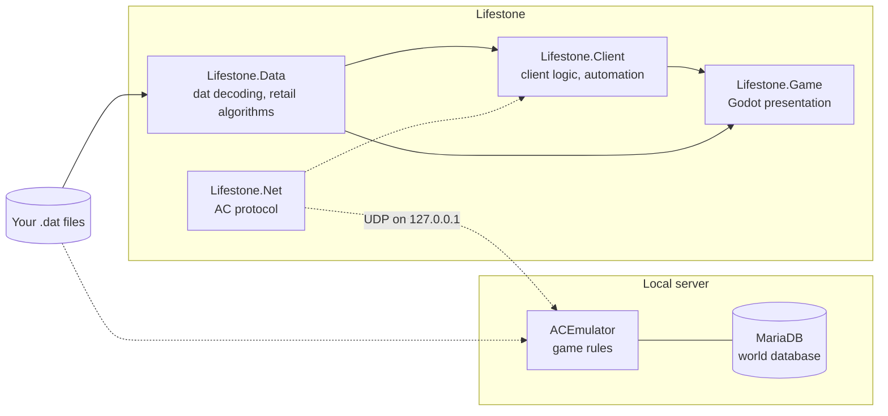

# Lifestone: the technical guide

The [README](README.md) says what Lifestone is. This is everything else: where the project stands, how to set it up,
the controls, how it's put together, how to build and test it, and the licences.

**Asheron's Call, rebuilt for one player: a new Godot client that draws Dereth from your own game files and plays
against a local ACEmulator server.**

> **Early development.** Milestones 1 to 5 are done and milestone 6 is at its candidate. You can fly or walk anywhere
> in Dereth, log in through the retail interface, fight, loot and trade, and hand a mage to the autopilot, which
> plays her by itself: a brand-new mage climbs from level 1 to 80 on her own, cheat-free.

Lifestone is a new client for Asheron's Call as it stood when the official servers closed in January 2017 (client
11.6096). It's written in C# on Godot 4.7.2 .NET and reads the `.dat` files from your own copy of the game. The game
rules come from [ACEmulator](https://github.com/ACEmulator/ACE) (ACE), the community's open-source server, which runs
on your machine. The things Decal plugins used to bolt on are part of the client: auto-buff is built in, and the
autopilot hunts, loots, sells, buys, does quests and levels a mage while you watch.

It is **not** an official product, it contains **none** of the game's files or code, and it is **not** an online
client: everything runs on your computer, the server listens on 127.0.0.1 only, and there's no multiplayer.

## Where it stands

| Milestone | State | What it brought |
|---|---|---|
| M1: Explore Dereth | Done | The whole world, rendered from your dats, to fly and walk through |
| [M2: Log in](docs/milestones/m2-log-in.md) | Done | The local server, retail login and portal space, the retail interface |
| [M3: Fights and sound](docs/milestones/m3-lights-and-sound.md) | Done | Magic in all three schools, projectiles, lights and the game's own sound |
| [M4: Fights and loot](docs/milestones/m4-fights-and-loot.md) | Done | Melee and missile, looting, kits and potions, vendors, auto-buff, a wayfinder |
| [M5: The first dungeon](docs/milestones/m5-first-dungeon.md) | Done | A mage that plays the Black Spawn Den by itself for hours (one run: ten hours, 1,910 kills, no deaths) |
| [M6: The level ladder](docs/milestones/m6-the-ladder.md) | Candidate | A fresh mage climbs from 1 to 80 by herself; it ends with a recorded sprint from creation to 80 |
| Next | Planned | More quests and NPCs, the remaining panels, more automation, larger windows, packaging |

**What you can do today:** explore Dereth at any time of day, inside buildings and down into dungeons; cast any spell
in the spell viewer; log in to the local server through retail's character screens; and play in the retail
interface, with its chat, vitals, inventory, spellbook, combat window, vendors and shortcut bar.

**The climb.** The level up job takes a new mage from the character screen to level 80 with no help from the server.
She starts at the Training Academy, then works up a ladder of hunting grounds: the Holtburg outskirts first, then
the tusker dungeons up to the Tusker Holding. She moves to the next ground only when its portal lets her in and her
own skill says she's ready. She goes home to sell and to buy spells and supplies, does quests along the way (kill
tasks, tusk turn-ins, fetches and the Atlan wand's whole chain), and uses a buff bot in Holtburg. She casts only from
her spell bar and drinks only from her hotbar, as a player would. If she dies, she re-arms, re-buffs, and works off
her vitae one ground down before going back for her corpse. You can steer her by typing orders in the chat.

**Not there yet:** most quests and NPC conversations, fellowships, crafting, housing, and some of retail's panels,
which say "Not in Lifestone" for now. Creatures that crowd you can still jump back to where the server has them
([physics](docs/physics.md)).

## Highlights

- **Retail visuals.** Terrain blending, scenery placement, buildings, interiors and the sky all follow retail's own
  algorithms, checked against reference renders. Only the cells you can see are drawn.
- **Smooth streaming.** Landblocks load around you in the background, so a 200 m/s flight from Holtburg to Arwic
  holds vsync.
- **The retail interface, rebuilt from the dats:** the same windows, fonts, icons and key map.
- **One action API.** The interface, the tests and the autopilot all act through it, and every action is checked
  against the server's answer.
- **A survival layer.** Keeping her alive comes first, over every fight, walk and trip: she fights back against
  anything that attacks her, manages her mana and stamina, drains and heals, and outruns creatures on the road.
- **A fight simulator.** `tools\fight-sim.ps1` runs ACE's own combat code offline against a real creature and her
  saved character. Every fight number in the project comes from it, from ACE's source or from the live logs
  ([fight simulator](docs/fight-sim.md)).
- **A wayfinder that's been everywhere.** It's checked by walking every landblock in Dereth offline, indoors and out
  ([world walk](docs/milestones/world-walk.md)).

## Quick start

Clone with Git and run everything from the repository root (written `<repo>` below). A downloaded ZIP works too,
but run `Unblock-File` on it first, or PowerShell will refuse the scripts.

**1. Install** (no administrator rights needed):

- Windows 10 or 11 (x64) and a GPU with Direct3D 12 or Vulkan.
- [PowerShell 7](https://learn.microsoft.com/powershell/scripting/install/installing-powershell-on-windows).
- The [.NET 10 SDK](https://dotnet.microsoft.com/download/dotnet/10.0) (see [`global.json`](global.json)). A per-user
  install in `%LOCALAPPDATA%\Microsoft\dotnet` is found by itself.
- Godot 4.7.2, .NET edition (`Godot_v4.7.2-stable_mono_win64.zip` from
  [godotengine/godot](https://github.com/godotengine/godot/releases)). Unzip it into a `Tools` folder beside your clone,
  so it ends up at `<repo>\..\Tools\Godot_v4.7.2-stable_mono_win64\`. Anywhere else, set `$env:LIFESTONE_GODOT` to the
  executable or pass `-GodotExe <path>`.

**2. Add your game files.** Copy these from your Asheron's Call folder (the one with `acclient.exe`) into
`<repo>\client`, which git ignores:

| File | Needed | Contents |
|---|---|---|
| `client_portal.dat` | Required | Models, textures, spells and animations (iteration 2072) |
| `client_cell_1.dat` | Required | Landblocks, buildings and dungeons (iteration 982) |
| `client_local_English.dat` | To play | Strings and the interface layouts (iteration 994) |
| `client_highres.dat` | Recommended | High-resolution textures (iteration 497) |

They're opened read-only. At start-up the log's `dats open` line should read `iterations=p2072-c982-l994-h497`; other
versions are untested.

**3. Explore:**

```powershell
pwsh -File tools\godot.ps1 -Run                                    # fly around Holtburg
pwsh -File tools\godot.ps1 -Run -GameArgs:'--start=arwic --walk'   # start on foot in Arwic
pwsh -File tools\godot.ps1 -Run -GameArgs:'--scene=spellviewer'    # the spell viewer
pwsh -File tools\godot.ps1 -Run -GameArgs:'--help'                 # every option
```

**4. Play on the local server.** Set it up once (it builds ACE, unpacks a portable MariaDB and loads the world; see
[server/README.md](server/README.md)), then play:

```powershell
pwsh -NoProfile -ExecutionPolicy Bypass -File server\setup-server.ps1
pwsh -File tools\play.ps1
```

`play.ps1` starts the server if it isn't running, signs you in (the password never goes on a command line) and stops
what it started when you quit.

**5. Watch the climb:** `pwsh -File tools\climb.ps1 -PlanOnly` shows every step without starting anything; drop
`-PlanOnly` to create a fresh climber and start her.

## Controls

**Exploring**

| Input | Action |
|---|---|
| `W` `A` `S` `D`, `E` / `Q` | Move; up / down when flying |
| Hold `Shift` / `Ctrl`, mouse wheel | Faster / slower; flying speed |
| Hold right mouse button, or `Tab` | Look around (`Esc` releases the mouse) |
| `F` | Fly or walk |
| `T`, `F7` | Teleport panel; next curated interior |
| `F3`, `F1`, `F9` | Performance overlay; About and licences; draw every loaded cell |

**Playing.** Retail's own key map, read from your dats. Lifestone adds:

| Input | Action |
|---|---|
| `1`-`9` | Cast from the spell bar in Magic mode; use a shortcut slot otherwise (`Alt` for slots 10-18) |
| `F7` | Lifestone's tools: search and teleport, where am I, add XP |
| `Scroll Lock` | The automation inspector (read-only) |
| `Pause` | Auto-buff on or off |
| `/auto`, `/stop` | Hand the controls to the autopilot, or take them back where it stands |
| `/trip`, `/rebuff`, `/quest <key>`, `/ladder`, `/home`, `/status` | Orders to a running autopilot ([commands](docs/commands.md)) |
| `Shift`+`Esc` | Log off |

Retail's chat commands work as they did (`/tell`, `/reply`, `/say`, `/afk`, `/lifestone`, `/marketplace` and so on).

## How it works



- **Lifestone.Data** decodes the dats and holds the retail algorithms: textures, models, terrain, scenery, cells,
  animation, particles and spells. No engine.
- **Lifestone.Client** decides what to load and show, holds the game state and the action API, and runs the
  automation. No engine, no sockets, no file access, so it's tested directly.
- **Lifestone.Game** is the Godot project, presentation only. AC's Z-up world becomes Godot's Y-up world in one
  place, `scripts/Core/AcToGodot.cs`.
- **Lifestone.Net** speaks the AC network protocol ([protocol](docs/protocol.md)).
- **The server** (`server/`) builds ACE from a pinned release and runs it with MariaDB as your user, on 127.0.0.1.
  AC was server-authoritative, so this is where the rules live. Lifestone's own server mod adds a few tools and the
  buff bot.

## Principles

- **Faithful, with sources.** Every algorithm and constant names where it came from: ACE, a retail client function,
  OpenAC, ACViewer or WorldBuilder. No retail code is copied. Unknowns are logged as named TODOs, never guessed.
- **Without retail's glitches.** Where retail had a visible bug, Lifestone fixes it and a flag brings it back
  (`--retail-normals`, `--retail-sky-anchor`).
- **Your machine stays yours.** No admin rights, installers, services or system settings. The game downloads nothing
  at runtime; only server setup goes online, for pinned, checksummed downloads. The client loads no outside code.
- **Automation plays fair.** It sends only the actions a player could, and only to a local server.

## Development

Build and run the tests (the full guide, with the live gate, the slice check and the smoke suite, is in
[docs/development.md](docs/development.md)):

```powershell
$env:DOTNET_CLI_TELEMETRY_OPTOUT = '1'; $env:DOTNET_NOLOGO = '1'
$env:DOTNET_ADD_GLOBAL_TOOLS_TO_PATH = 'false'; $env:DOTNET_GENERATE_ASPNET_CERTIFICATE = 'false'
dotnet build Lifestone.slnx --disable-build-servers
dotnet test Lifestone.slnx --disable-build-servers --filter "Category!=Loopback&Tier!=Soak&Tier!=Exhaustive&Tier!=Timing&Tier!=Tool&Status!=KnownFailure"
```

Warnings are errors. Tests that need the dats skip without them. That filter leaves out the tests that need the
local server, the long soaks, the full dat sweeps, the lead-run tools, the wall-clock tests
(`[Trait("Tier","Timing")]`, run alone on a quiet machine) and any known failure (`[Trait("Status","KnownFailure")]`,
none today). `pwsh -File tools\smoke.ps1` runs the whole integration suite off-screen.

**Layout:** `src/` holds the six projects, `tests/` their tests, `server/` the local backend and the mod, `tools/` the
launcher and scripts, and `docs/` the design notes, milestones and [third-party sources](docs/third-party/). Start with
the [goals](docs/goals.md), the [session model](docs/session.md) and the [automation engine](docs/automation-engine.md).

**Contributing.** Issues and pull requests are welcome, under the repository's licence. Name the source of every
retail behaviour you add, never commit retail data or anything rendered from it, keep the build at zero warnings, and
check rendering changes against the golden viewpoints. Coding agents follow [`CLAUDE.md`](CLAUDE.md).

## FAQ

**Do I need the original game?** Yes, its data files. Lifestone includes none of them; it reads yours without
changing them.

**Can I play online or with friends?** No. It's single-player, and the server only listens on your own machine.

**Why not run the retail client against a local ACE?** You can. Lifestone is for what that can't give you: a modern
engine, retail visuals without retail's glitches, a client you can read and change, and automation built in.

**Why Godot?** It's open source, runs C# well and is small to ship. Everything but the presentation lives in plain
.NET libraries, so the engine could be swapped.

**Linux or macOS?** Not yet: it's built and tested on Windows only.

## License

Lifestone is free software under the **GNU Affero General Public License v3.0** (see [LICENSE](LICENSE)) and comes
with **no warranty**. Whether that's "AGPL-3.0-only" or "or-later" isn't decided yet; the two data files taken from
ACE's world database are AGPL-3.0-only. The same notices are in the game's About panel (`F1`).

Lifestone builds on these works, which keep their own licenses:

| Work | License | Used for |
|---|---|---|
| ACEmulator (ACE) | AGPL-3.0 | the bundled server; game rules and algorithms ported from its source |
| ACE-World-16PY-Patches | AGPL-3.0 | the world database: places, portals and spell visuals |
| OpenAC | MIT | terrain blending code (TexMerge); network transport and message codecs |
| Chorizite DatReaderWriter | MIT | reading the dat files |
| WorldBuilder | MIT | landscape and terrain blending reference |
| ACViewer | GPL-3.0 | terrain blending, named locations and test oracles |
| Godot Engine | MIT | the game engine |

Server setup also builds ACE and downloads MariaDB Server 11.4 (GPL-2.0) on your machine; neither is stored here or
redistributed ([server/README.md](server/README.md#licensing)). NuGet packages come from nuget.org only:
Chorizite.DatReaderWriter 2.1.9 (MIT), the Godot C# SDK 4.7.2 (MIT), and xunit, its runner and the test SDK for
tests (Apache-2.0 / MIT).

Asheron's Call and its data files belong to their owners. Lifestone isn't affiliated with or endorsed by them, and
this repository holds no retail game data: you must supply your own client files. That is also why there are no
screenshots here: every render shows retail game data.

The people whose work Lifestone stands on are thanked in the [README](README.md#thank-you).
